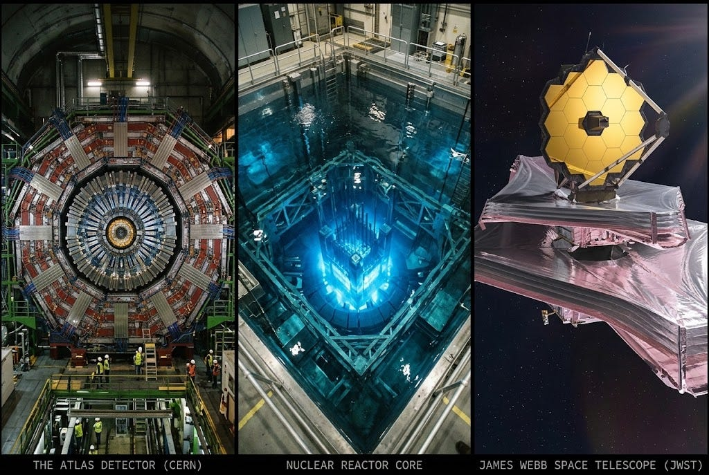
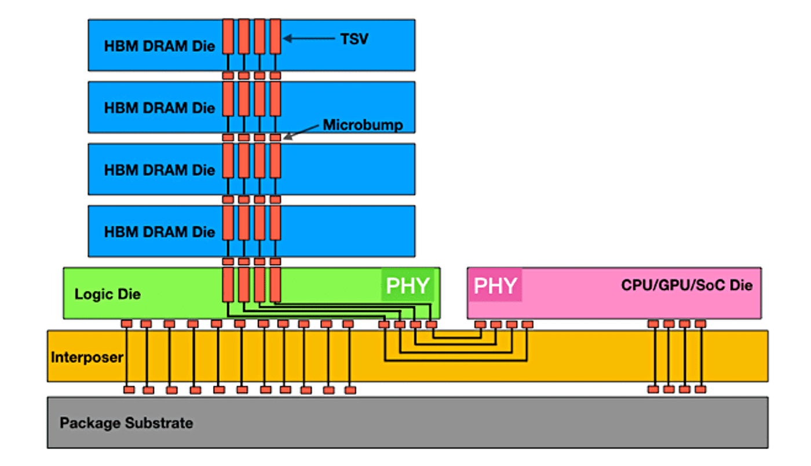
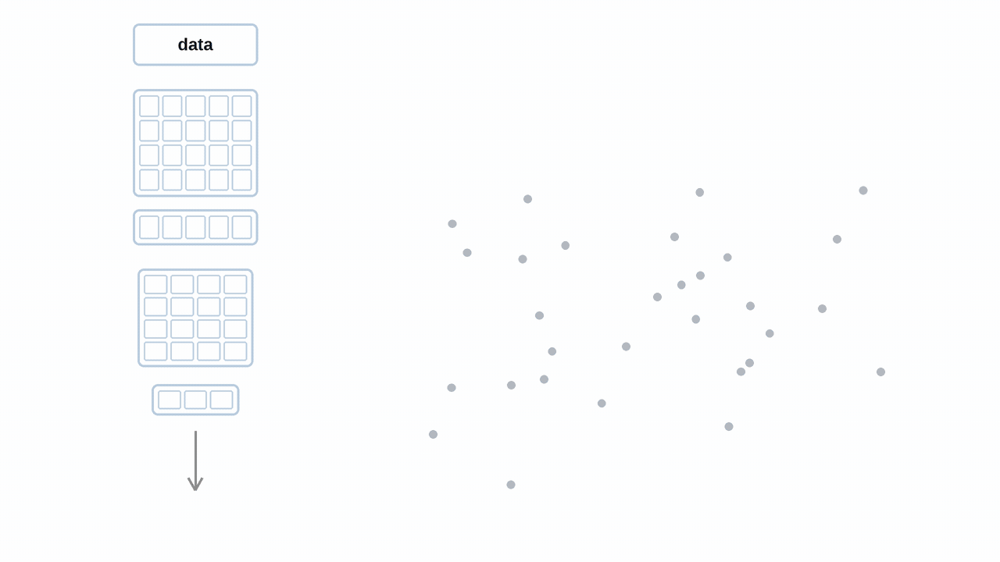
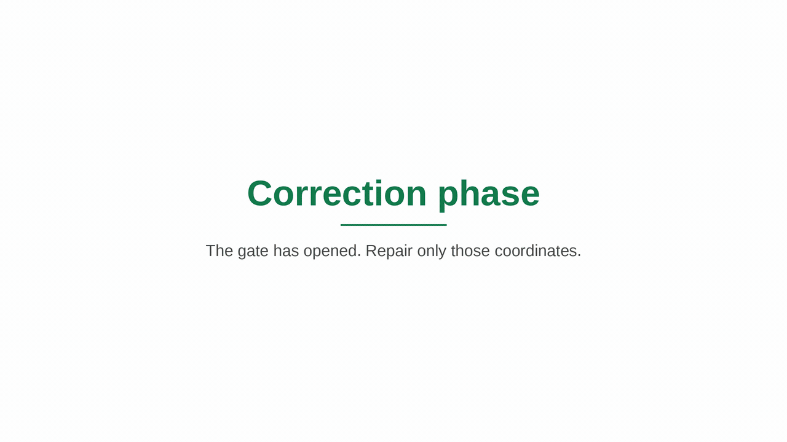

<!-- twitter -->
<meta name="twitter:title" content="Hardening Neural Networks for Space">
<meta name="twitter:card" content="summary_large_image">
<meta name="twitter:image" content="https://bair.berkeley.edu/static/blog/hardening-intelligence/image1.jpg">

<meta name="keywords" content="radiation hardening, fault tolerance, neural networks, projection healing, high bandwidth memory">
<meta name="description" content="Projection Healing lets a neural network detect radiation-induced bit flips and repair its weights and activations at inference time.">
<meta name="author" content="Peter Ma, Joshua S. Bloom">

**TL;DR:** We developed a mechanism for a neural network to self-heal its weights and activations at inference time to combat radiation-induced bit flips. [Read our paper here][1].

Advanced AI models are entering some of the most extreme environments in the universe. Think particle accelerators, nuclear reactors, and deep space.

This demand is driven both by our scientists charting new physical frontiers and also by the current multi-trillion dollar AI buildout to deliver planetary-scale commoditised intelligence from space.

<!--more-->

<p style="text-align:center;">

<br>
<i><b>Extreme environments for fault-tolerant neural networks.</b> The ATLAS detector at CERN (left), a nuclear reactor core (center), and the James Webb Space Telescope (right). Image made with Gemini.</i>
</p>

One of the tallest immediate barriers is that these environments are unbelievably hostile. Decades of work and hundreds of PhD theses have been poured into hardening our instruments, our compute, and our software to survive these conditions.

But intelligence remains fundamentally brittle. We set out to tackle this challenge.

Starting from first principles: what actually makes these environments so hostile?

One common denominator is radiation, and the culprit is the High Bandwidth Memory (HBM) used to serve these models. HBM achieves its performance by vertically stacking memory dies (sometimes up to 12 layers high) to store a model’s weights.

<p style="text-align:center;">

<br>
<i><b>Stacked High Bandwidth Memory.</b> HBM reaches its bandwidth by stacking DRAM dies and connecting them with through-silicon vias. Source: Semiconductor Engineering.</i>
</p>

When a high-energy particle strikes silicon, it ionizes a track through the chip and deposits charge that can flip a gate, silently corrupting a model’s weights. Thankfully, modern memory usually features Error Correcting Codes (ECC); however, standard ECC is designed to fix isolated, single-bit errors. This doesn’t save us, because High Bandwidth Memory uses a densely stacked 3D architecture, where a single particle can tear both laterally across a die and vertically through the stack. This creates a cluster of corrupted cells known as a Multi-Bit Upset (MBU), which standard ECC cannot address.

## Our solution

What we developed is a mechanism for a given neural network to sense and detect damage to its weights and activations, giving it a means to self-heal that damage at inference time. How do we do this? We accomplish this via something we call Projection Healing. [Read our preprint here][1].

One of the many prevalent hypotheses for the effectiveness of neural networks is the idea of manifold learning. Simply put, real data lives on a lower-dimensional surface immersed in a higher-dimensional ambient space. At training time, a neural network learns to exploit this property to optimally perform estimations. It is this assumption that we can use to design our fault-tolerant mechanisms.

Consider a random bit flip. This bit flip can cause faulty arithmetic, giving seemingly nonsense answers. The problem is, how do we know these are nonsense answers at inference time when there’s no ground truth to check? Since we believe that data, along with a model’s intermediate representations, lives on a low-dimensional manifold, small perturbations can easily push you off the manifold. Why is that the case? Well, it’s simply because there are fundamentally many more directions for “things to go wrong” that aren’t aligned with your manifold.

<p style="text-align:center;">

<br>
<i><b>Off the manifold.</b> Clean data lives on a lower-dimensional surface. A bit flip pushes a representation into one of the many directions that are not on that surface.</i>
</p>

This reframes the fault-tolerance problem to: can you accurately detect when you pop off the manifold, and can you project yourself back down to the manifold afterward?

Our work shows that you can.

The first stage is detection. The goal is to isolate the “syndrome” vector that we need to surgically remove. What we do is apply a projection matrix onto a given row vector and then subtract the projected row vector from its original vector. The key property of the projection matrix is that vectors that live in the lower-dimensional subspace remain unaffected, while vectors that aren’t in the subspace are mapped to a new vector that is in the subspace. Thus, the game of detecting faults is to simply measure the change with and without applying the projection matrix. If the difference in the vector is zero, then great: the syndrome is zero and the gate closes. If it’s large, then the gate opens.

<p style="text-align:center;">

<br>
<i><b>Detection.</b> Project the vector and subtract. A difference of zero means the gate stays closed. A large difference is the syndrome, and the gate opens.</i>
</p>

Then comes the correction. This syndrome vector is then used to determine which coordinates to downscale and which to leave alone, like a mask for good entries and bad entries. This is needed because we know that, depending on your memory layout, only certain weights or vector entries are affected, not all of them. So this mechanism lets us be precise and surgical. This creates a temporary “clean” vector with a corresponding mask.

However, here’s where the next issue comes in. Simply masking out a vector component like that neutralizes the immediate spike, but we still need to somehow inpaint the missing value. In other words, this temporary masked-out clean vector doesn’t guarantee you are actually in the right manifold space. So what you need to do is apply the projection map onto this masked vector to inpaint the missing values.

But another problem arises. By inpainting it this way, you accidentally mix up all the other clean signals that don’t need to be inpainted. So what you do is multiply the original vector by the complement of the mask and add the inpainted values. This allows you to preserve the nearly perfect vector you started with and fill in the inpainted, corrected values afterward.

<p style="text-align:center;">

<br>
<i><b>Correction.</b> Once the gate opens, only the damaged coordinates are repaired, and the missing values are inpainted back onto the manifold.</i>
</p>

Fundamentally, the intuition behind this double-projection business is that if we used a single projection, it would both see the fault and keep a piece of it, because the projection operator mixes values together, which would smear out the problem instead of fixing it. This was the key insight to making it work.

## Conclusion

Together, this mechanism, along with Fault-Aware Training, helped demonstrate a 2× increase in survivability compared with an unprotected network on commodity hardware.

We believe that this new data-driven abstraction stack calls for a novel model co-design approach to tackle these challenging environments, one that is orthogonal to traditional hardware or software lines of defense.

As we race and accelerate to the next frontier in science, there remains substantial green field in developing the next sets of rails for this new layer of intelligence at scale.

---

<i>This post is based on the paper “A Radiation-Hardened, Fault-Aware Quantized Neural Network That Self-Heals,” by Peter Xiangyuan Ma and Joshua S. Bloom. You can read the preprint [here][1].</i>

## Citation

```bibtex
@article{ma2026radiationhardened,
  title={A Radiation-Hardened, Fault-Aware Quantized Neural Network That Self-Heals},
  author={Peter Xiangyuan Ma and Joshua S. Bloom},
  year={2026},
  eprint={2610.27621},
  archivePrefix={arXiv},
  primaryClass={cs.LG},
  url={https://arxiv.org/abs/2610.27621}
}
```

<i>Disclosure: AI has been used to proof-edit this work, as well as in carrying out the experiment and the development of the work.</i>

[1]:https://arxiv.org/abs/2610.27621
